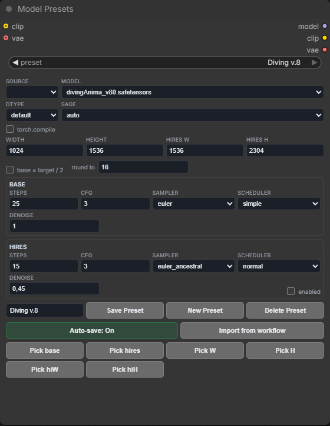

# ComfyUI Model Presets

A preset switcher for diffusion models: one node instead of a wall of bypassed
loaders and samplers. Model files and their per-model settings live in
`model_presets.json`, and the node applies them to real `KSampler` nodes in the
workflow.

Built for Anima workflows, but not tied to Anima: any model from
`diffusion_models` or `checkpoints` works.



## Features

- **Named model presets**: model file, weight dtype, sage attention,
  torch.compile, resolution, and base + hires sampler settings.
- **Two sampling stages per preset**: base and hires (refine), each with its own
  steps / CFG / sampler / scheduler / denoise. The hires stage can be disabled.
- **Resolution formula**: store a target size and let the node compute the base
  size (`target / 2`, rounded to 16), or disable the division and use the value
  as is.
- **Works inside subgraphs**: target nodes are addressed by graph id + node id,
  so the node can live in the same subgraph as the samplers it drives.
- **Import from workflow**: scans the open workflow (including subgraph
  definitions) for model loaders and `KSampler` pairs and creates presets from
  them.
- **Auto-save**: panel edits are written to JSON and applied to the targets
  after a short pause and again right before the prompt is queued.

## Installation

Not in the ComfyUI Manager registry yet: clone it manually.

```bash
cd ComfyUI/custom_nodes
git clone https://github.com/BoberJac/ComfyUI-ModelPresets
```

Restart ComfyUI. The node appears as **Model Presets** under `loaders`.

No extra Python dependencies. Sage attention / torch.compile are applied only if
[ANIMA Booster](https://github.com/) is installed; otherwise the node loads the
model with native attention and logs a warning.

## Where to put the node

Either place works:

- **Inside the subgraph that owns the samplers**: it replaces the model loaders
  there and its `MODEL` output goes to that subgraph's `MODEL` output.
- **At the root**: its `MODEL` output feeds the LoRA chain (or whatever comes
  next), and the sampling subgraph takes the returned model through its own
  `model` input. In that case remove/bypass the old loaders inside the
  subgraph, otherwise the sampler keeps using them and the preset model is
  never applied.

`CLIP` / `VAE` inputs stay empty when the text encoder and VAE are loaded
elsewhere (the usual Anima setup); in that case leave the `clip` / `vae` outputs
unconnected too.

## Node

| Socket | Type | Description |
| --- | --- | --- |
| `preset` | combo | Preset name. The list comes from `model_presets.json`. |
| `clip` | `CLIP` (optional) | Pass-through input. Use it when the model and the text encoder are loaded separately. |
| `vae` | `VAE` (optional) | Pass-through input. |

| Output | Type |
| --- | --- |
| `model` | `MODEL` |
| `clip` | `CLIP` |
| `vae` | `VAE` |

For a checkpoint preset (`source: "checkpoint"`) the node loads MODEL, CLIP and
VAE from the checkpoint and ignores the optional inputs. For a diffusion model
preset (`source: "model"`) it loads only MODEL, so connect CLIP and VAE from your
own loaders.

## Targets

The panel edits settings, but a `KSampler` widget cannot be driven by a link
(`sampler_name` and `scheduler` are combo widgets), so the frontend writes the
values into real nodes. Bind them once per workflow:

1. Press `Pick base` (or `Pick hires`, `Pick W`, `Pick H`, `Pick hiW`, `Pick hiH`).
2. Click the target node on the canvas, even if it lives in another subgraph.
3. Press the same button again to cancel pick mode.

The panel shows the bound node under the buttons. Subgraph instances are rejected
(pick the node inside the subgraph). If a `width`/`height` widget is linked, pick
the node that holds the number instead (`PrimitiveInt`, subgraph input).

## Preset format

```json
{
  "Diving v.8": {
    "source": "model",
    "model": "divingAnima_v80.safetensors",
    "weight_dtype": "default",
    "sage_attention": "auto",
    "torch_compile": false,
    "width": 1200,
    "height": 1800,
    "divide": true,
    "round_to": 16,
    "hires_width": 1280,
    "hires_height": 1920,
    "base":  { "steps": 25, "cfg": 3, "sampler": "euler", "scheduler": "simple", "denoise": 1 },
    "hires": { "enabled": true, "steps": 15, "cfg": 3, "sampler": "euler_ancestral", "scheduler": "normal", "denoise": 0.45 }
  }
}
```

`divide: true` turns `1200x1800` into `608x912` (`round(1200/2/16)*16`). With
`divide: false` the size is used as written (rounded to `round_to` if it is
greater than 1).

The file is stored next to the node and is **not** committed to this repository:
it is user data. Start from `model_presets.example.json`.

## Notes and limitations

- **Subgraph instances share widget values.** In ComfyUI's subgraph system a
  node inside a subgraph belongs to the subgraph *definition*, so two instances
  of the same subgraph share the same preset and sampler values. Keep one
  instance per model subgraph, or duplicate the subgraph definition rather than
  the instance.
- **Queueing from the API without the UI** uses the values last applied and
  saved in the workflow. Model files are read from JSON by Python at execution
  time; sampler settings are widget values.
- The hires stage is not bypassed when disabled; only its values are not applied.

## License

MIT, see [LICENSE](LICENSE).
